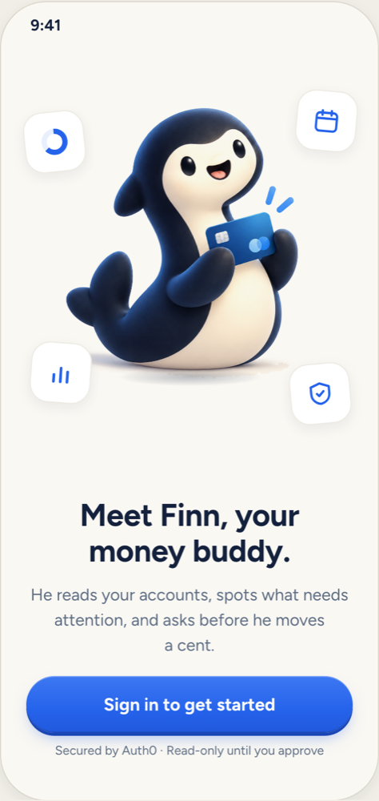
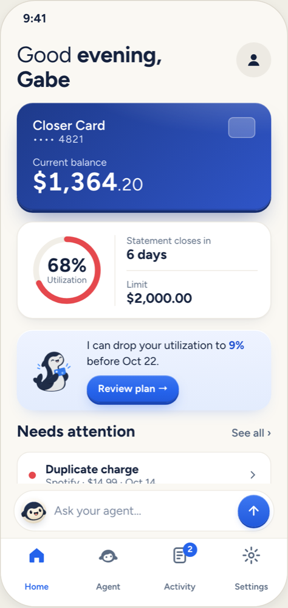
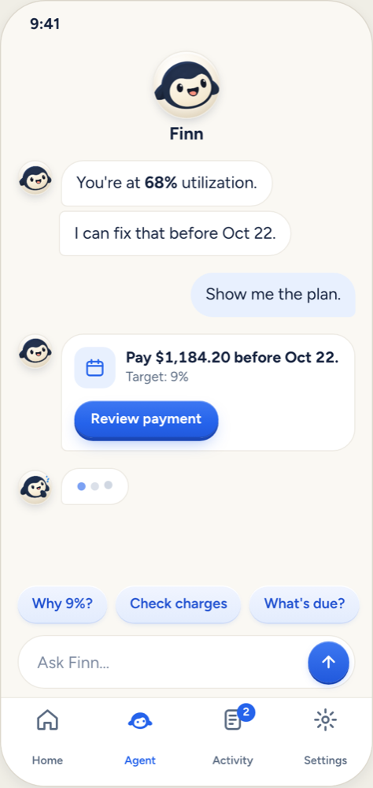
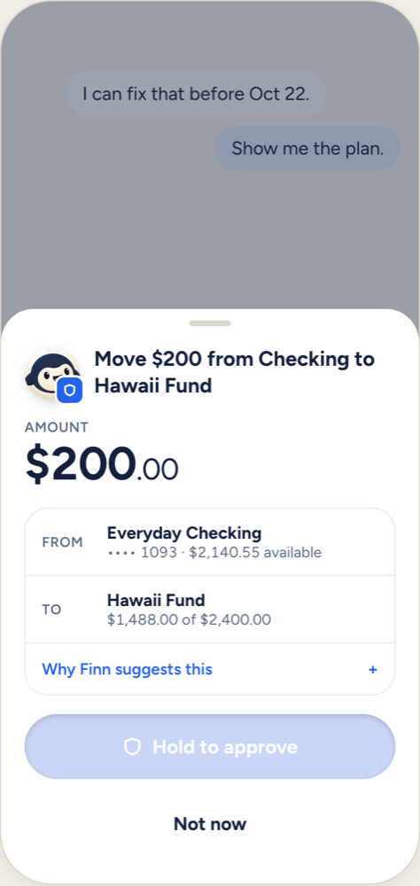
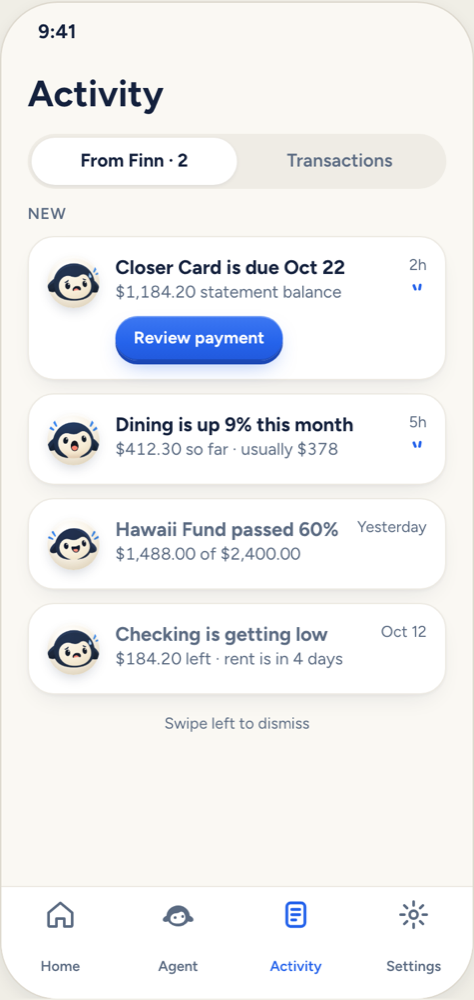
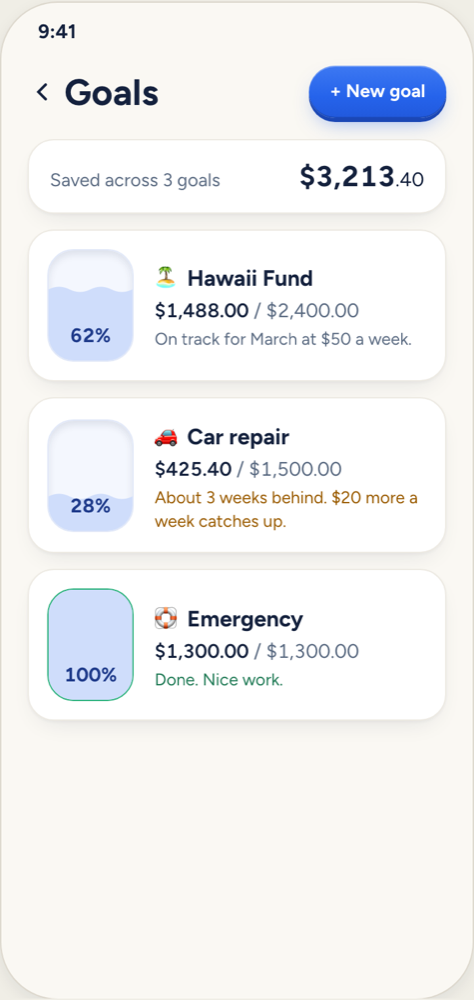

<p align="center">
  
</p>

<h1 align="center">Finni</h1>

<p align="center">
  A banking app you run by texting Finn, a money companion who speaks up before things go wrong.
</p>

<p align="center">
  
  
  
  
</p>

## Why we built it

Most people open their banking app after something has already gone wrong: an overdraft, a forgotten bill, or a month of small purchases that added up. By then it's too late to change anything. Budgeting tools could help, but they take work to set up and most people give up on them.

Finni turns that around. Finn watches your accounts and tells you what's coming, so you can fix it while you still have time.

## What Finn does

**Speaks up first.** Finn warns you before a bill is due, when your spending jumps, or when checking is about to run short before payday. Each warning comes with a fix you can accept in one tap.

**Answers plain questions.** Ask "What did I spend on food this week?", "Can I afford this?", or "Where's the nearest ATM?" and get a straight answer drawn from your real balances.

**Keeps you on track with savings goals.** Tell Finn what you're saving for. He opens a savings account for it, tracks your progress, and tells you when you fall behind and how much it takes to catch up.

**Acts only with your OK.** Finn can move money, pay a bill, or set up a goal, but nothing happens until you hold to approve. Anything over $100 also needs Face ID.

<p align="center">
  
  
</p>

## How it's built

| Part | Stack |
| --- | --- |
| Mobile app (`apps/mobile`) | Expo, React Native, Expo Router, TanStack Query, Reanimated, Rive |
| API (`apps/api`) | Node, Express, Drizzle ORM, Postgres on Supabase |
| Agent | Google Gemini with tool calls, plus fallback models for when the main one is overloaded |
| Banking data | Capital One Nessie API |
| Auth | Auth0, plus a per-device demo mode for Expo Go |
| Shared types (`packages/shared`) | TypeScript and Zod contracts used by both the app and the API |

## Run it locally

You need a current Node LTS, a Supabase Postgres database, a Nessie API key, and a Gemini API key. The app runs in Expo Go on your phone.

1. Install dependencies from the repo root.

   ```sh
   npm install
   ```

2. Copy `apps/api/.env.example` to `apps/api/.env` and fill in `NESSIE_KEY`, `GEMINI_API_KEY`, and `DATABASE_URL`. Set `AUTH_MODE=demo` for Expo Go. Each phone then signs in with its own device id. The server refuses demo mode when `NODE_ENV=production`.

3. Copy `apps/mobile/.env.example` to `apps/mobile/.env`. Keep `EXPO_PUBLIC_AUTH_MODE=demo` and set `EXPO_PUBLIC_DEMO_NAME` to the first name Finn should call you.

4. Set up the database once.

   ```sh
   npm run db:push -w @finni/api
   npm run seed:merchants -w @finni/api
   ```

5. Start the API on port 4000.

   ```sh
   npm run api
   ```

6. In a second terminal, start the app and scan the QR code with Expo Go. Your phone and laptop need to be on the same Wi-Fi.

   ```sh
   npm run mobile
   ```

On first launch you'll see "Finn is getting your accounts ready" while it creates your demo accounts. To start over, use "Reset demo data" in Settings.

### If your phone can't reach the API

Campus and hotel Wi-Fi often block devices from talking to each other. If the loading screen says "Couldn't reach Finni at ...", use tunnels instead:

1. From `apps/mobile`, run `npx expo start --tunnel`.
2. Expose the API, for example with `npx localtunnel --port 4000`.
3. Put that URL in `EXPO_PUBLIC_API_URL` in `apps/mobile/.env` and restart Expo.

### Checks

```sh
npm run typecheck
npm test -w @finni/api
npm test -w @finni/mobile
```

## Project layout

```
apps/
  api/        Express API, Finn agent, nudge engine, Nessie client
  mobile/     Expo app
packages/
  shared/     Types and API contracts shared by both apps
docs/         Design references and screenshots
```

Built at SwampHacks XII.
